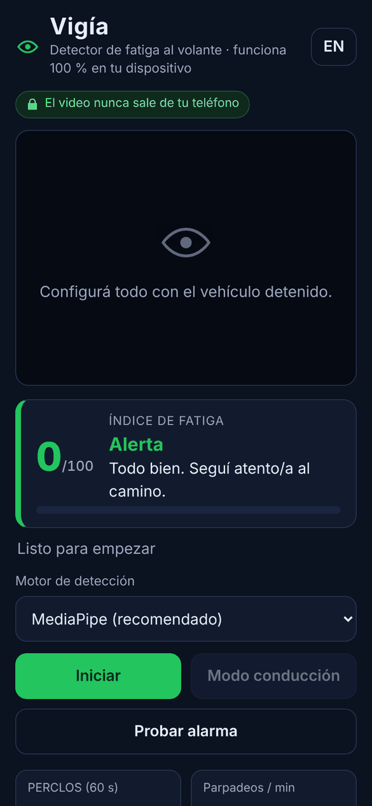
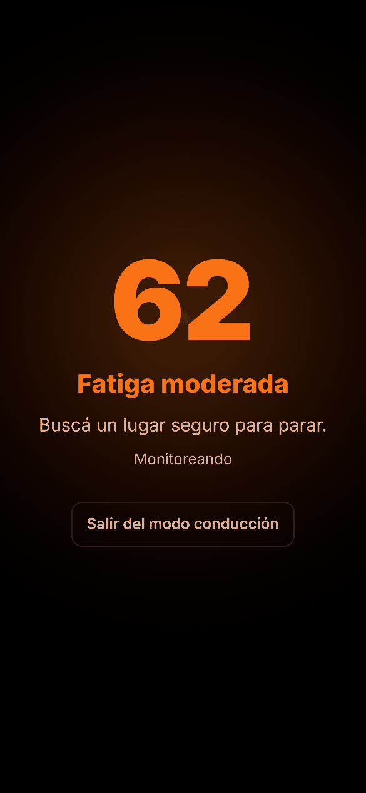
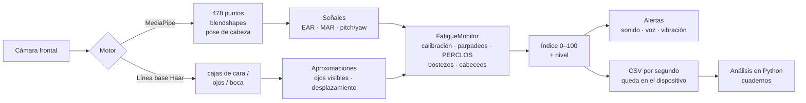
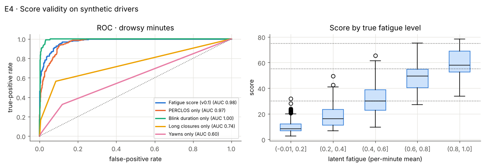

<div align="center">

# 👁️ Vigía

**Detector de fatiga al volante que funciona 100 % en el navegador: sin instalar nada, sin servidor y sin que el video salga del teléfono.**

[🇬🇧 Read in English](README.md) · [Demo en vivo](https://nicorojasdev.github.io/vigia/) · [Demo del Laboratorio](https://nicorojasdev.github.io/vigia/#lab) · [Informe de ciencia de datos](docs/es/informe-ciencia-de-datos.md) · [Metodología](docs/es/metodologia.md) · [Privacidad y legal](docs/es/privacidad-y-legal.md)


[](https://github.com/NicoRojasDev/vigia/actions/workflows/tests.yml)

</div>

> **Estado: prototipo de investigación v0.1.** Vigía es un proyecto educativo de código abierto. **No** es un
> dispositivo médico ni un sistema de seguridad certificado, y **ninguna app reemplaza el descanso**.

<p align="center">
  
  &nbsp;&nbsp;
  
  <br/><sub>Pantalla principal y modo conducción (estado de ejemplo "fatiga moderada").</sub>
</p>

## La problemática

- En Argentina murieron **3894 personas en siniestros viales en 2024** (casi 10 por día), según datos oficiales
  de la ANSV recopilados por la [UADE](https://uade.edu.ar/media/qkdjxlmz/seguridad-vial-informe-insod-final-_.pdf).
- La asociación civil *Luchemos por la Vida* advierte que manejar con fatiga extrema
  [equivale a superar el límite legal de alcohol en sangre](https://www.iprofesional.com/actualidad/459961-el-peligroso-habito-al-volante-que-aumenta-el-riesgo-de-choque-un-33).
- En EE. UU., la NHTSA estima que [entre el 2 % y el 20 % de las muertes viales anuales](https://www.nhtsa.gov/node/138456)
  se deben a la somnolencia, y es un problema muy subregistrado.
- Los sistemas de monitoreo del conductor existen, pero casi siempre en autos nuevos y caros o en equipos para
  flotas. Camioneros, choferes de micros y repartidores que hacen rutas largas y monótonas (como las rutas
  nacionales 9 y 34 que cruzan Santiago del Estero) rara vez tienen uno.

**La idea de Vigía:** usar el teléfono que todos ya tienen. Se coloca en un soporte, se abre una página web y
avisa cuando aparecen signos de fatiga. Gratis, privado desde el diseño y de código abierto.
Más contexto: [docs/es/problema-e-impacto.md](docs/es/problema-e-impacto.md).

## Qué hace

| | |
|---|---|
| 🎯 **Indicadores de fatiga** | Relación de aspecto del ojo (EAR), **PERCLOS** (la métrica de referencia de somnolencia), frecuencia y duración del parpadeo, cierres largos de ojos (tipo microsueño), bostezos (MAR) y cabeceos / giros de cabeza |
| 🧍 **Calibración personal** | 10 s de línea base para cada conductor, así los umbrales se adaptan a cada cara |
| 📈 **Índice de fatiga 0–100** | Índice ponderado, transparente y documentado, con 4 niveles: alerta · leve · moderada · alta |
| 🔔 **Alertas escalonadas** | Sonidos generados por código, voz y vibración, con pausas para evitar la "fatiga de alarmas"; alarma inmediata si los ojos quedan cerrados ≥ 1,5 s |
| 🚗 **Modo conducción manos libres** | Vista mínima a pantalla completa, fácil de leer de un vistazo; mantiene la pantalla encendida |
| ⚖️ **Dos motores para comparar** | **MediaPipe Face Landmarker** moderno (478 puntos) vs. la línea base clásica de **cascadas Haar con OpenCV.js** (el prototipo original) |
| 🔒 **Privacidad desde el diseño** | Todo corre en el dispositivo. Una Content-Security-Policy bloquea cualquier conexión saliente, incluidas las métricas de uso de MediaPipe |
| 🧾 **Mis datos (en memoria)** | Tabla en vivo de los últimos segundos, registro de eventos y todas las sesiones de la página, guardadas solo en memoria y borradas al refrescar; exportación a CSV/JSON |
| 🔬 **Pestaña Laboratorio de datos** | La mirada de ciencia de datos sobre cualquier sesión, en el navegador: descomposición del índice, EAR vs. umbral personal, histogramas, estadística descriptiva, mapa de correlaciones, explorador de variables e informe automático bilingüe. Abrí un CSV o [cargá el ejemplo sintético](https://nicorojasdev.github.io/vigia/#lab) |
| 📊 **Herramientas de ciencia de datos** | Paquete de Python, estudio de simulación con verdad conocida, tests y cuadernos |
| 🌐 **Bilingüe** | Interfaz y documentación en español (Argentina) e inglés |

## Cómo funciona



Fórmulas clave (detalle y referencias en la [metodología](docs/es/metodologia.md)):

- **EAR** = (‖p2 − p6‖ + ‖p3 − p5‖) / (2 ‖p1 − p4‖). El ojo se considera "cerrado" si EAR < 65 % de la base personal.
- **PERCLOS** = proporción de cuadros con los ojos cerrados en los últimos 60 s.
- **Índice** = 100 × (0,45·PERCLOS + 0,20·cierres largos + 0,15·bostezos + 0,10·duración del parpadeo + 0,10·cabeceos),
  cada componente satura en un nivel documentado y luego se suaviza en el tiempo.

## 📊 Informe de ciencia de datos

**¿Se puede confiar en el detector?** Las grabaciones reales casi nunca dicen exactamente cuándo se cerró un ojo,
así que la lógica se evaluó primero con **54 conductores sintéticos (≈ 107 horas simuladas) con verdad conocida**,
corriendo *el mismo* `FatigueMonitor` que la app. Informe completo:
**[docs/es/informe-ciencia-de-datos.md](docs/es/informe-ciencia-de-datos.md)**.

| Experimento | Resultado clave (datos sintéticos) |
|---|---|
| **E1 · Umbral de ojo cerrado × ruido** | Con r = 0,65: recall de parpadeos **1,00**, precisión **0,998**, recall de cierres largos **0,96**. Un umbral alto con cámara ruidosa baja la precisión a **0,62** |
| **E2 · Cuadros por segundo** | Desde 15 cuadros/s no se pierden parpadeos; a 5 se pierde el **40 %**. La alarma de microsueño llega **≈ 1,6 s** después de cerrar los ojos |
| **E3 · Calibración personal** | Un umbral fijo da **≈ 744 falsos parpadeos/h** a personas de ojos rasgados; con calibración personal, **0** → es un tema de equidad |
| **E4 · Validez del índice** | Ordena los minutos somnolientos con **AUC 0,978** (IC 95 % 0,962–0,988). El corte manual "moderado" es conservador (recall 0,28); el óptimo ROC (≈ 23) llega a recall 0,97 → **los umbrales tienen que aprenderse con etiquetas reales** |

<p align="center">
  
</p>

- **La misma matemática en dos lenguajes:** `web/js/metrics.js` y `analysis/vigia_analysis/features.py` comparten
  casos de prueba, así un modelo entrenado en Python se comporta igual en el navegador.
- **Límites honestos:** los datos sintéticos codifican nuestros supuestos (por ejemplo, la duración del parpadeo
  depende de la fatiga por construcción). Próximo paso: datasets públicos y un piloto voluntario con etiquetas KSS/PVT.
- **Cuadernos:** [01 análisis de sesión](analysis/notebooks/01_session_analysis.ipynb) ·
  [02 estudio de simulación](analysis/notebooks/02_simulation_study.ipynb).

## Privacidad y legalidad desde el diseño

- 🎥 El video se procesa cuadro a cuadro en memoria y **nunca se graba ni se sube**.
- 🧮 Solo se guardan números agregados por segundo, en memoria (la pestaña *Mis datos* los muestra), se borran al
  refrescar y se exportan únicamente si la persona toca *Descargar*. Los CSV abiertos en el Laboratorio se leen
  localmente, nunca se suben.
- 🚫 Sin cuentas, cookies, almacenamiento local, analíticas ni reconocimiento facial.
- 🛡️ La Content-Security-Policy de la página solo permite descargar el código y el modelo; el navegador bloquea
  todo lo demás (probado: las solicitudes al servidor de métricas de uso de MediaPipe se rechazan).
- 🚦 Pensado según la Ley Nacional de Tránsito 24.449: se configura con el vehículo detenido, en soporte fijo,
  **sin auriculares** y sin tocar el teléfono mientras se maneja.

Análisis completo de la normativa argentina (Ley 25.326, Res. AAIP 4/2019, Convenio 108+, Ley 24.449, ANMAT):
[docs/es/privacidad-y-legal.md](docs/es/privacidad-y-legal.md).

## Inicio rápido

**Probarlo:** abrí la [demo en vivo](https://nicorojasdev.github.io/vigia/) en el celular (la cámara necesita HTTPS).

**Correrlo en tu compu** (Python 3 y Node 20+):

```bash
git clone https://github.com/NicoRojasDev/vigia.git
cd vigia
python -m http.server 8000 --directory web   # abrí http://localhost:8000
```

**Tests y análisis:**

```bash
npm test                                   # tests de JavaScript (node:test)
node scripts/simulate_session.mjs          # regenera el CSV de la sesión sintética
node scripts/simulation_study.mjs          # vuelve a correr el estudio de simulación (≈ 20 s)
cd analysis
pip install -r requirements.txt
pytest                                     # tests de Python
jupyter notebook notebooks/01_session_analysis.ipynb
```

## Estructura del proyecto

```
vigia/
├── web/                     # la app (sitio estático, sin compilación)
│   ├── index.html           # interfaz + Content-Security-Policy
│   ├── js/
│   │   ├── config.js        # todos los umbrales, documentados
│   │   ├── metrics.js       # EAR, MAR, pose de cabeza (funciones puras)
│   │   ├── fatigue.js       # FatigueMonitor: calibración, eventos, PERCLOS, índice
│   │   ├── session.js       # registro por segundo + CSV/JSON (en memoria)
│   │   ├── stats.js         # descriptiva, cuantiles, Pearson, MCO, histograma, lector CSV
│   │   ├── report.js        # informe automático bilingüe de la sesión
│   │   ├── lab.js, charts.js, dataset.js   # Laboratorio de datos y gráficos en canvas
│   │   ├── alerts.js        # sonido, voz, vibración
│   │   ├── engines/         # mediapipe-engine.js · haar-engine.js
│   │   └── main.js, i18n.js, camera.js
│   ├── data/                # ejemplo sintético para el Laboratorio
│   ├── models/haar/         # cascadas Haar (cara, ojos, boca)
│   └── vendor/opencv/       # OpenCV.js 4.5.2
├── analysis/                # paquete de Python, tests, cuadernos y resultados del estudio
├── tests/                   # tests de JS + casos compartidos con Python
├── scripts/                 # simulador de sesiones, estudio de simulación, conductores sintéticos
└── docs/en · docs/es        # documentación bilingüe
```

## Limitaciones

Los umbrales son valores por defecto tomados de la literatura y **todavía no están validados**; la cámara
necesita luz (no tiene infrarrojo), y los anteojos de sol, las sombras fuertes o un mal soporte empeoran los
resultados. Ver [ética y limitaciones](docs/es/etica-y-limitaciones.md).

## Hoja de ruta

v0.2 comparación con datasets públicos · v0.3 PWA sin conexión con recursos propios · v0.4 piloto voluntario con
etiquetas KSS/PVT · v0.5 modelo entrenado y exportado al navegador. Detalle: [docs/es/hoja-de-ruta.md](docs/es/hoja-de-ruta.md).

## Tecnologías

JavaScript (módulos ES, sin framework) · MediaPipe Tasks Vision · OpenCV.js · APIs Web Audio / Speech Synthesis /
Screen Wake Lock · Python (NumPy, pandas, Matplotlib, pytest) · Jupyter · GitHub Actions y Pages.

## Créditos y licencia

Código bajo [licencia MIT](LICENSE). Los componentes de terceros (OpenCV, cascadas Haar, MediaPipe y su modelo)
conservan sus propias licencias: ver [THIRD_PARTY_NOTICES.md](THIRD_PARTY_NOTICES.md).

**Autor:** Carlos Nicolás Rojas — estudiante de Ciencia de Datos e Inteligencia Artificial (ITSE, Santiago del
Estero, Argentina) · [LinkedIn](https://www.linkedin.com/in/nicolas-rojas-5594902ba) · [GitHub](https://github.com/NicoRojasDev)
