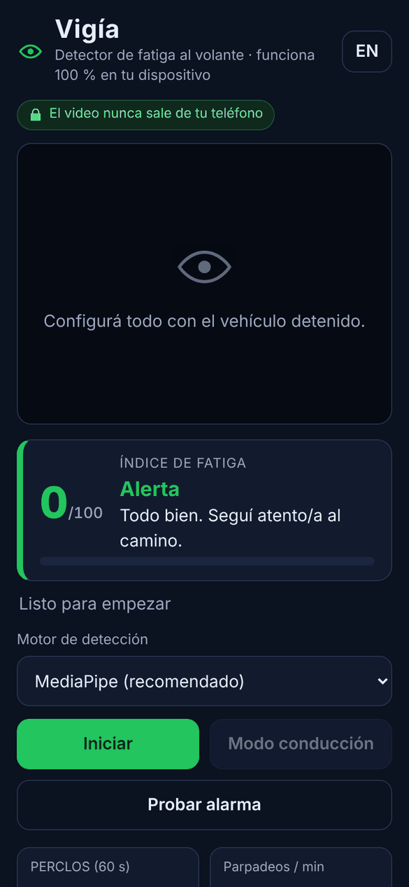
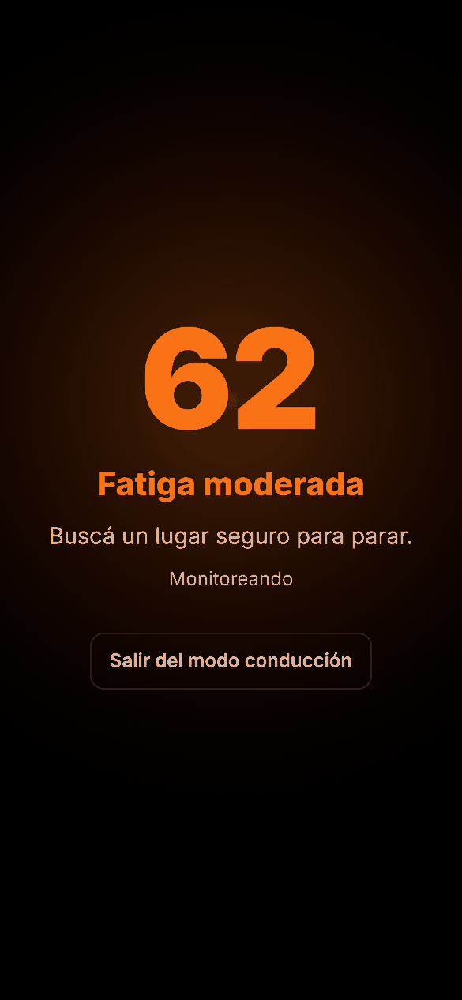
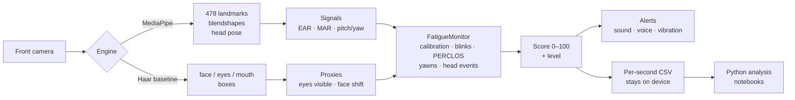
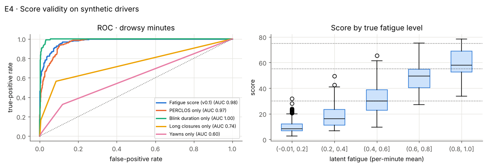

<div align="center">

# 👁️ Vigía

**Driver fatigue detection that runs 100% in the browser — no app install, no server, no video leaving the phone.**

[🇪🇸 Leer en español](README.es.md) · [Live demo](https://nicorojasdev.github.io/vigia/) · [Data Lab demo](https://nicorojasdev.github.io/vigia/#lab) · [Data science report](docs/en/data-science-report.md) · [Methodology](docs/en/methodology.md) · [Privacy & legal](docs/en/privacy-and-legal.md)


[](https://github.com/NicoRojasDev/vigia/actions/workflows/tests.yml)

</div>

> **Status: v0.1 research prototype.** Vigía is an open-source educational project. It is **not** a medical
> device or a certified safety system, and **no app replaces rest**.

<p align="center">
  
  &nbsp;&nbsp;
  
  <br/><sub>Main screen and driving mode (example state "moderate fatigue").</sub>
</p>

## The problem

- Argentina recorded **3,894 road deaths in 2024** (≈ 10 per day), according to official ANSV data
  compiled by [UADE](https://uade.edu.ar/media/qkdjxlmz/seguridad-vial-informe-insod-final-_.pdf).
- Road-safety NGO *Luchemos por la Vida* warns that driving with extreme fatigue is
  [comparable to exceeding the legal blood-alcohol limit](https://www.iprofesional.com/actualidad/459961-el-peligroso-habito-al-volante-que-aumenta-el-riesgo-de-choque-un-33).
- In the US, NHTSA estimates that [2% to 20% of annual traffic deaths](https://www.nhtsa.gov/node/138456) are
  attributable to drowsiness — and it is notoriously under-reported.
- Driver-monitoring systems exist, but mostly in new, expensive vehicles or fleet hardware. Long-distance
  truckers, bus and delivery drivers on long, monotonous routes (like national routes 9 and 34 across
  Santiago del Estero) rarely have one.

**Vigía's idea:** use the phone everyone already carries. Mount it, open a web page, and get an alert when
signs of fatigue appear — free, private by design and open source.
More context: [docs/en/problem-and-impact.md](docs/en/problem-and-impact.md).

## What it does

| | |
|---|---|
| 🎯 **Fatigue indicators** | Eye Aspect Ratio (EAR), **PERCLOS** (the reference drowsiness metric), blink rate and duration, long eye closures (microsleep-like), yawns (MAR) and head nods / turns |
| 🧍 **Personal calibration** | 10 s baseline for each driver, so thresholds adapt to different faces |
| 📈 **Fatigue score 0–100** | Transparent, documented weighted score with 4 levels: alert · mild · moderate · high |
| 🔔 **Escalating alerts** | Generated sounds, voice and vibration, with cooldowns to avoid alarm fatigue; immediate alarm for eyes closed ≥ 1.5 s |
| 🚗 **Hands-free driving mode** | Minimal, glanceable full-screen view; keeps the screen awake |
| ⚖️ **Two engines to compare** | Modern **MediaPipe Face Landmarker** (478 landmarks) vs. the classic **OpenCV.js Haar cascades** baseline (the original prototype) |
| 🔒 **Privacy by design** | Everything runs on the device. A Content-Security-Policy blocks any outgoing connection — including MediaPipe's usage metrics |
| 🧾 **My data (in memory)** | Live table of the last seconds, event log and every session of the page — kept only in memory and deleted on refresh; export to CSV/JSON |
| 🔬 **Data Lab tab** | The data-science view of any session, in the browser: score decomposition, EAR vs personal threshold, histograms, descriptive statistics, correlation heatmap, variable explorer and an automatic bilingual report. Open a CSV or [load the synthetic example](https://nicorojasdev.github.io/vigia/#lab) |
| 📊 **Data-science toolkit** | Python package, simulation study with known ground truth, tests and notebooks |
| 🌐 **Bilingual** | Spanish (Argentina) and English UI and docs |

## How it works



Key formulas (details and references in the [methodology](docs/en/methodology.md)):

- **EAR** = (‖p2 − p6‖ + ‖p3 − p5‖) / (2 ‖p1 − p4‖) — eye "closed" when EAR < 65% of the personal baseline.
- **PERCLOS** = share of frames with the eyes closed over the last 60 s.
- **Score** = 100 × (0.45·PERCLOS + 0.20·long closures + 0.15·yawns + 0.10·blink duration + 0.10·head events),
  each sub-score saturating at a documented level, then smoothed in time.

## 📊 Data science report

**Can we trust the detector?** Real recordings rarely say exactly when an eye closed, so the logic was first
evaluated on **54 synthetic drivers (≈ 107 simulated hours) with known ground truth**, running the *same*
`FatigueMonitor` code as the app. Full report: **[docs/en/data-science-report.md](docs/en/data-science-report.md)**.

| Experiment | Key result (synthetic data) |
|---|---|
| **E1 · Closed-eye threshold × noise** | Default r = 0.65: blink recall **1.00**, precision **0.998**, long-closure recall **0.96**. A high threshold with a noisy camera drops precision to **0.62** |
| **E2 · Frame rate** | ≥ 15 fps loses no blinks; 5 fps loses **40 %**. Microsleep alarm **≈ 1.6 s** after eye closure |
| **E3 · Personal calibration** | A fixed threshold gives narrow-eyed drivers **≈ 744 false blinks/h**; personal calibration **0** → a fairness issue |
| **E4 · Score validity** | Drowsy minutes ranked with **AUC 0.978** (95 % CI 0.962–0.988). The hand-set "moderate" cut-off is conservative (recall 0.28); the ROC-optimal cut-off (≈ 23) reaches recall 0.97 → **thresholds must be learned from real labels** |

<p align="center">
  
</p>

- **Same maths in two languages:** `web/js/metrics.js` and `analysis/vigia_analysis/features.py` share test
  fixtures, so a model trained in Python behaves the same in the browser.
- **Honest limits:** synthetic data encodes our assumptions (e.g. blink duration is tied to fatigue by
  construction). Next: public datasets and an opt-in pilot with KSS/PVT labels.
- **Notebooks:** [01 session analysis](analysis/notebooks/01_session_analysis.ipynb) ·
  [02 simulation study](analysis/notebooks/02_simulation_study.ipynb).

## Privacy & legal, by design

- 🎥 Video is processed frame by frame in memory and **never recorded or uploaded**.
- 🧮 Only aggregated numbers per second are kept, in memory (the *My data* tab shows them), deleted on refresh,
  and only exported if the user taps *Download*. CSVs opened in the Data Lab are read locally, never uploaded.
- 🚫 No accounts, cookies, local storage, analytics or face recognition.
- 🛡️ The page's Content-Security-Policy only allows downloading the code and model; everything else is
  blocked by the browser (tested: requests to MediaPipe's usage-metrics endpoint are refused).
- 🚦 Designed around Argentina's traffic law (Ley 24.449): set up while stopped, fixed mount, **no headphones**,
  hands-free operation.

Full analysis of Argentine law (Ley 25.326, AAIP Res. 4/2019, Convention 108+, Ley 24.449, ANMAT):
[docs/en/privacy-and-legal.md](docs/en/privacy-and-legal.md).

## Quick start

**Try it:** open the [live demo](https://nicorojasdev.github.io/vigia/) on your phone (HTTPS is required for the camera).

**Run locally** (Python 3 and Node 20+):

```bash
git clone https://github.com/NicoRojasDev/vigia.git
cd vigia
python -m http.server 8000 --directory web   # open http://localhost:8000
```

**Tests and analysis:**

```bash
npm test                                   # JavaScript unit tests (node:test)
node scripts/simulate_session.mjs          # regenerate the synthetic session CSV
node scripts/simulation_study.mjs          # re-run the simulation study (≈ 20 s)
cd analysis
pip install -r requirements.txt
pytest                                     # Python tests
jupyter notebook notebooks/01_session_analysis.ipynb
```

## Project structure

```
vigia/
├── web/                     # the app (static site, no build step)
│   ├── index.html           # UI + Content-Security-Policy
│   ├── js/
│   │   ├── config.js        # every threshold, documented
│   │   ├── metrics.js       # EAR, MAR, head pose (pure functions)
│   │   ├── fatigue.js       # FatigueMonitor: calibration, events, PERCLOS, score
│   │   ├── session.js       # per-second recorder + CSV/JSON (in memory)
│   │   ├── stats.js         # describe, quantiles, Pearson, OLS, histogram, CSV parser
│   │   ├── report.js        # automatic bilingual session report
│   │   ├── lab.js, charts.js, dataset.js   # Data Lab view and canvas charts
│   │   ├── alerts.js        # sound, voice, vibration
│   │   ├── engines/         # mediapipe-engine.js · haar-engine.js
│   │   └── main.js, i18n.js, camera.js
│   ├── data/                # synthetic example for the Data Lab
│   ├── models/haar/         # Haar cascades (face, eyes, mouth)
│   └── vendor/opencv/       # OpenCV.js 4.5.2
├── analysis/                # Python toolkit, tests, notebooks, study results
├── tests/                   # JS tests + fixtures shared with Python
├── scripts/                 # session simulator, simulation study, synthetic drivers
└── docs/en · docs/es        # bilingual documentation
```

## Limitations

Thresholds are literature-based defaults, **not yet validated**; the camera needs light (no infrared), and
sunglasses, strong shadows or a bad mount degrade results. See
[ethics & limitations](docs/en/ethics-and-limitations.md).

## Roadmap

v0.2 benchmark on public datasets · v0.3 offline PWA with self-hosted assets · v0.4 opt-in pilot with KSS/PVT
labels · v0.5 learned model exported to the browser. Details: [docs/en/roadmap.md](docs/en/roadmap.md).

## Tech stack

JavaScript (ES modules, no framework) · MediaPipe Tasks Vision · OpenCV.js · Web Audio / Speech Synthesis /
Screen Wake Lock APIs · Python (NumPy, pandas, Matplotlib, pytest) · Jupyter · GitHub Actions & Pages.

## Credits & licence

Code under the [MIT licence](LICENSE). Third-party components (OpenCV, Haar cascades, MediaPipe and its
model) keep their own licences: see [THIRD_PARTY_NOTICES.md](THIRD_PARTY_NOTICES.md).

**Author:** Carlos Nicolás Rojas — Data Science & AI student (ITSE, Santiago del Estero, Argentina) ·
[LinkedIn](https://www.linkedin.com/in/nicolas-rojas-5594902ba) · [GitHub](https://github.com/NicoRojasDev)
