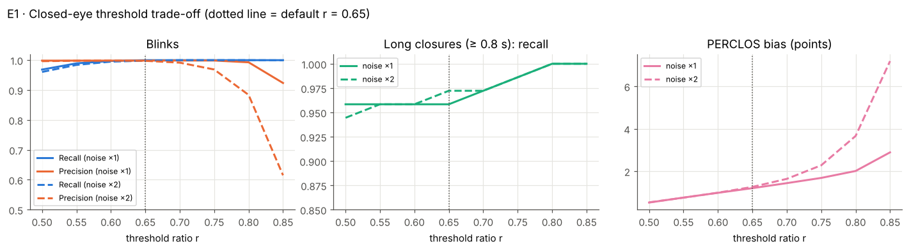
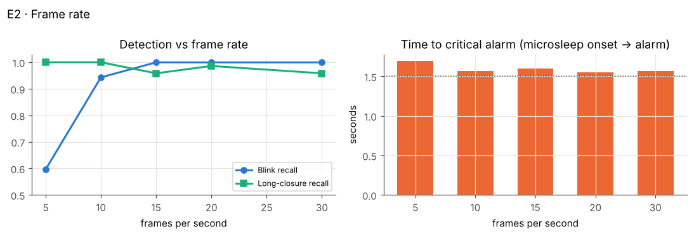
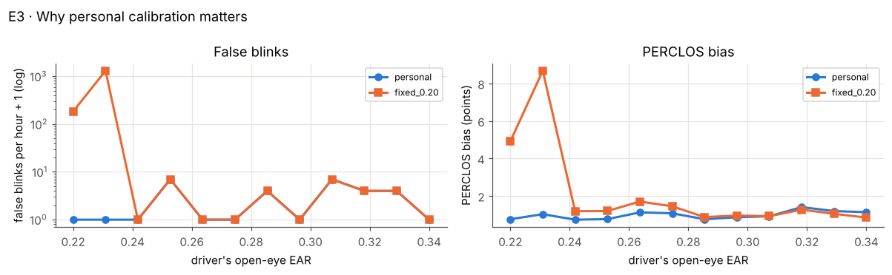
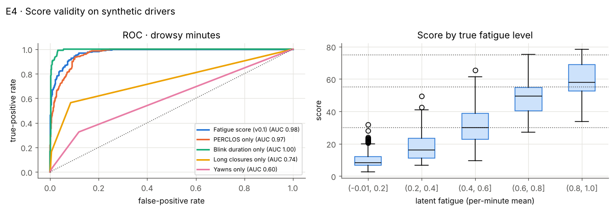

# Data science report — Vigía v0.1

[🇪🇸 Versión en español](../es/informe-ciencia-de-datos.md) · [← Back to README](../../README.md) ·
Notebooks: [01 session analysis](../../analysis/notebooks/01_session_analysis.ipynb) ·
[02 simulation study](../../analysis/notebooks/02_simulation_study.ipynb)

> **Scope.** This report evaluates Vigía's detection logic and fatigue score on **synthetic drivers with known
> ground truth**. It shows how the algorithm behaves and where its trade-offs are; it does **not** prove accuracy
> on real people. Real-data validation is the next step (§ 9).

## 1. Executive summary

**What was built:** an on-device pipeline (camera → face signals → events → 0–100 fatigue score), an in-browser
**Data Lab** to inspect any session, and a reproducible **simulation study**: 54 synthetic drivers and
≈ 107 simulated hours run through the *same* `FatigueMonitor` code the app uses.

| # | Question | Result (synthetic) |
|---|---|---|
| E1 | Is the default closed-eye threshold (r = 0.65) a good choice? | Blink recall **1.00**, precision **0.998**; long-closure recall **0.958**; PERCLOS bias **+1.2 pts**. With a noisy camera, a high threshold (r = 0.85) drops blink precision to **0.62**. |
| E2 | What does a slow phone (or the Haar engine) lose? | From **15 fps** no blinks are lost; at **5 fps** recall falls to **0.60**. Microsleep alarm arrives **≈ 1.6 s** after eye closure at every rate. |
| E3 | Does personal calibration matter? | Yes. A fixed threshold gives drivers with narrow eyes **≈ 744 false blinks/hour** and **+6.8 PERCLOS points**; personal calibration: **0** and **+0.9**. It is a **fairness** issue. |
| E4 | Does the score track fatigue? | Ranks drowsy minutes with **AUC 0.978** (95 % CI 0.962–0.988, bootstrap by driver), above PERCLOS alone (0.966), long closures (0.745) and yawns (0.604). But the hand-set "moderate" cut-off (55) is **conservative**: precision 1.00, recall **0.28**. The ROC-optimal cut-off is ≈ **23** (recall 0.97, false-positive rate 0.12). |

**Main takeaway:** the features and the score *rank* fatigue well, but the **level thresholds should be learned
from labelled data** rather than set by hand — exactly what the next version needs real labels for.

## 2. Framing the problem as data science

| Aspect | Decision |
|---|---|
| Target | Drowsiness, a latent state. Real-world proxies: Karolinska Sleepiness Scale (KSS ≥ 7) and PVT lapses |
| Units | Frame (≈ 30/s) → events → per-second rows → per-minute windows (modelling unit) |
| Output | Events (blink, long closure, critical closure, yawn, head deviation) + 0–100 score + 4 levels |
| Constraints | On-device (privacy, Law 25.326), real-time (< 33 ms per frame at 30 fps), explainable, fair across faces |
| Error costs | Missed alarms are the most dangerous; false alarms erode trust ("alarm fatigue"), so both are reported |
| Leakage control | All aggregate metrics are pooled per driver and CIs use **driver-level bootstrap**; future models use `GroupKFold` by person |

## 3. Data

### 3.1 Live sessions (privacy-preserving by design)

The app never stores images or landmarks. Per second it keeps 28 aggregated columns (EAR, MAR, PERCLOS, blink
stats, head pose, events, the **contribution of each component to the score**, and processing latency), plus an
event log and a frame-level EAR sample for histograms — **only in memory**, until the page is refreshed. Users can
export CSV/JSON (the JSON includes the configuration and personal baseline for reproducibility).
Data dictionary: [methodology § 7](methodology.md#7-output-data-per-second-csv).

### 3.2 Synthetic drivers with ground truth

[`scripts/lib/synthetic.mjs`](../../scripts/lib/synthetic.mjs) generates each driver with:

- a personal open-eye EAR (0.22–0.34), camera noise, blink habits and a latent fatigue curve f(t) ∈ [0, 1]
  (25 % of drivers stay alert);
- eye closures with **closing/opening ramps** (70 / 110 ms), longer blinks and more long closures/microsleeps as
  f grows;
- confounders that must **not** trigger alarms: talking and laughing (mouth movement), mirror checks
  (< 1.1 s head turns), moments with the face out of frame;
- yawns and head nods whose rate grows with f.

Ground truth for PERCLOS uses the classic **P80** definition (eyelid ≥ 80 % closed). Seeds are fixed, so every
number in this report is reproducible.

## 4. Features and model

| Feature | Definition | Why |
|---|---|---|
| EAR | (‖p2−p6‖ + ‖p3−p5‖) / (2‖p1−p4‖), 6 landmarks per eye | Scale-invariant eye opening (Soukupová & Čech, 2016) |
| PERCLOS | Share of frames with eyes closed in 60 s | Reference ocular drowsiness measure (Dinges & Grace, 1998) |
| Blink rate / duration | From closure episodes 50–800 ms | Blinks get slower with sleepiness |
| Long / critical closures | Episodes ≥ 0.8 s / ≥ 1.5 s | Microsleep-like events; critical triggers an immediate alarm |
| Yawns | MAR ≥ max(0.5, baseline + 0.3) for ≥ 1.5 s | Complementary sign; hysteresis avoids talking false positives |
| Head deviation | Pitch > 20° or yaw > 30° for ≥ 1.5 s | Nods; short mirror checks are ignored |

**Score v0.1** = 100 × (0.45·PERCLOS + 0.20·long closures + 0.15·yawns + 0.10·blink duration + 0.10·head),
each component saturating at a documented level, smoothed with τ = 3 s. Because every component is exported
(`c_*` columns), the Data Lab can show **why** the score is what it is — an explainable baseline that a learned model
must beat.

## 5. Results

### E1 — Closed-eye threshold × camera noise



12 drivers × 20 min × 8 thresholds × 2 noise levels. Low thresholds miss short blinks; high thresholds with a
noisy camera invent blinks and inflate PERCLOS. The default **r = 0.65** stays in the stable region for both
noise levels and is also the F1-optimal value under double noise. The few missed long closures sit right at the
0.8 s boundary: eyelid ramps shorten the measured duration — a measurement bias worth correcting when real
labels exist.

### E2 — Frame rate



| fps | 5 | 10 | 15 | 20 | 30 |
|---|---:|---:|---:|---:|---:|
| Blink recall | 0.60 | 0.94 | 1.00 | 1.00 | 1.00 |
| Long-closure recall | 1.00 | 1.00 | 0.96 | 0.99 | 0.96 |
| Microsleeps detected | 100 % | 100 % | 100 % | 100 % | 100 % |
| Time to critical alarm (s) | 1.69 | 1.56 | 1.60 | 1.55 | 1.57 |

A 150 ms blink can fall between two frames at 5 fps (coarse frames also round long closures *up*, which is why
low rates do not miss them). The Haar engine's 15 fps target is enough for blinks; the
microsleep alarm is dominated by the 1.5 s rule, not by the camera.

### E3 — Personal calibration vs fixed threshold



With a fixed absolute threshold (EAR < 0.20), drivers with narrower eyes (open EAR ≈ 0.22) are flooded with
false blinks (≈ 744 per hour) and their PERCLOS is inflated by ≈ 6.8 points — the app would call them tired all
the time. Personal calibration removes the effect. **One threshold does not fit every face**: this is the
algorithmic-fairness argument for the 10-second calibration.

### E4 — Does the score track fatigue?



30 drivers × 30 min = 900 minutes, 24 % labelled drowsy (latent fatigue ≥ 0.5).

| Feature | ROC-AUC |
|---|---:|
| **Fatigue score v0.1** | **0.978** (95 % CI 0.962–0.988) |
| PERCLOS only | 0.966 |
| Blink duration only | 0.995 ⚠️ |
| Long closures only | 0.745 |
| Yawns only | 0.604 |

| Cut-off | Precision | Recall | False-positive rate |
|---|---:|---:|---:|
| "Moderate" level (score ≥ 55) | 1.00 | 0.28 | 0.00 |
| ROC-optimal (Youden, score ≥ 23) | 0.73 | 0.97 | 0.12 |

- The score **ranks** drowsy minutes very well and beats isolated events.
- ⚠️ Blink duration looks near-perfect **because the generator ties it directly to f(t)**: a property of the
  simulator, not evidence. Real data must confirm or refute it.
- The hand-set level cut-offs are **conservative**: almost no false alarms, but early drowsiness is caught late
  (median **2 min** after latent fatigue crosses 0.5; IQR 1–5 min). 1 of 22 drowsy drivers never reached
  "moderate"; 1 of 8 alert drivers had one false "moderate" alarm.
- **Decision:** v0.5 will learn the cut-offs from labelled data, choosing the missed-alarm vs false-alarm trade-off
  explicitly (e.g. with a cost-weighted ROC point).

## 6. The Data Lab: data science inside the product

The **Data Lab** tab ([try it with the synthetic example](https://nicorojasdev.github.io/vigia/#lab)) runs the
same analysis on any session, in the browser: KPIs and data-quality checks, score over time with level bands,
**score decomposition** (stacked contributions), EAR with the personal threshold, PERCLOS, EAR histogram,
a variable explorer (histogram + scatter vs score + OLS slope + Pearson r), descriptive statistics,
a correlation heatmap, the event log, an **automatic bilingual report** (trend by linear regression,
first vs last third, top correlations, data quality, caveats) and CSV/JSON/Markdown export. Statistics are
implemented in [`web/js/stats.js`](../../web/js/stats.js) with NumPy-compatible conventions and unit tests.

## 7. Reproducibility and quality

- **Tests:** 31 JavaScript + 15 Python, shared fixtures so the browser and Python compute identical EAR/MAR, and
  a schema test that keeps the CSV columns in sync across languages.
- **Determinism:** fixed seeds; `node scripts/simulation_study.mjs` regenerates every result in ≈ 20 s;
  `analysis/results/simulation/summary.json` holds the numbers quoted here.
- **Exports** carry the configuration and app version.

## 8. Threats to validity

1. **Synthetic data.** The generator encodes our assumptions (ramp shapes, how blink duration and long closures
   grow with fatigue). Results describe the algorithm under those assumptions.
2. **EAR from a phone camera** is noisier than the simulated noise when lighting, glasses or vibration are poor;
   E1's double-noise condition is only a partial stress test.
3. **Labels.** "Drowsy = latent fatigue ≥ 0.5" is a modelling choice; real labels (KSS, PVT) are noisier and
   subjective.
4. **No temporal model.** Minutes are treated as independent in the AUC; per-driver bootstrap mitigates but does
   not remove autocorrelation.
5. **Population.** The MediaPipe model card reports a fairness evaluation, but Vigía has not yet been evaluated
   on real people across skin tones, ages, glasses or lighting.

## 9. Next steps (prioritised)

1. **Benchmark on public data** (UTA-RLDD, NTHU-DDD, YawDD; research licences): event metrics and Haar vs MediaPipe.
2. **Opt-in pilot** with written consent: KSS every 5 min + 3-min PVT, only while stopped or in a simulator.
3. **Learned model:** per-minute features → regularised logistic regression with `GroupKFold` by person;
   calibrated probabilities (reliability curve); cost-aware threshold; export coefficients to JSON for the browser.
4. **Fairness report** by subgroup and lighting condition.

## 10. Reproduce

```bash
node scripts/simulation_study.mjs          # regenerate the study (≈ 20 s)
node scripts/simulate_session.mjs          # regenerate the 30-min sample session
cd analysis && pip install -r requirements.txt
pytest                                     # Python tests
jupyter notebook notebooks/02_simulation_study.ipynb
```

References: see [methodology § 10](methodology.md#10-references).
