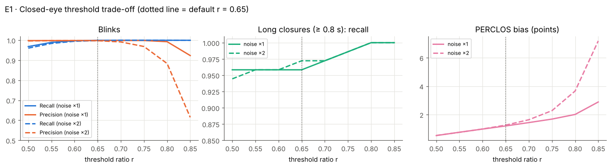
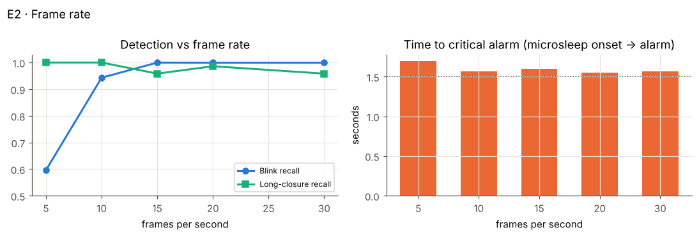
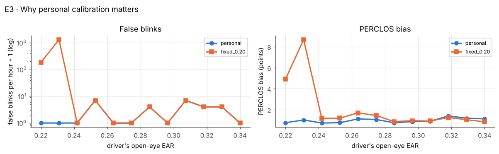
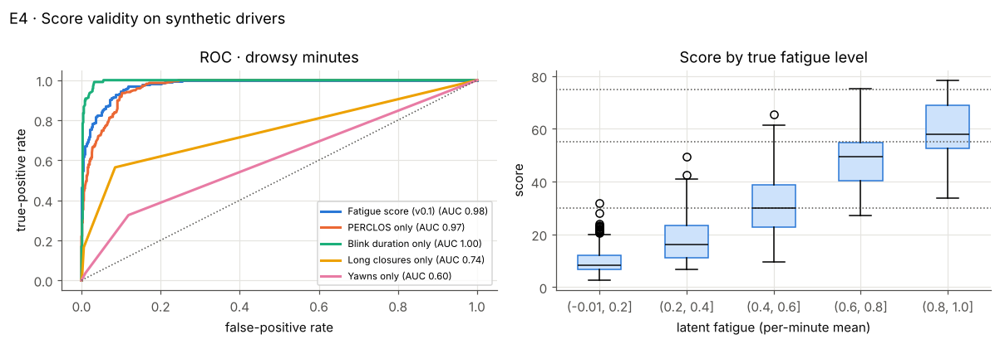

# Informe de ciencia de datos — Vigía v0.1

[🇬🇧 English version](../en/data-science-report.md) · [← Volver al README](../../README.es.md) ·
Cuadernos: [01 análisis de sesión](../../analysis/notebooks/01_session_analysis.ipynb) ·
[02 estudio de simulación](../../analysis/notebooks/02_simulation_study.ipynb)

> **Alcance.** Este informe evalúa la lógica de detección y el índice de fatiga de Vigía con **conductores
> sintéticos cuya verdad se conoce**. Muestra cómo se comporta el algoritmo y dónde están sus compromisos; **no**
> demuestra su exactitud en personas reales. Validar con datos reales es el próximo paso (§ 9).

## 1. Resumen ejecutivo

**Qué se construyó:** un circuito que corre en el dispositivo (cámara → señales del rostro → eventos → índice de
fatiga 0–100), un **Laboratorio de datos** dentro del navegador para analizar cualquier sesión, y un **estudio de
simulación** reproducible: 54 conductores sintéticos y ≈ 107 horas simuladas que pasan por *el mismo*
`FatigueMonitor` que usa la app.

| # | Pregunta | Resultado (sintético) |
|---|---|---|
| E1 | ¿Es bueno el umbral de "ojo cerrado" por defecto (r = 0,65)? | Recall de parpadeos **1,00**, precisión **0,998**; recall de cierres largos **0,958**; sesgo de PERCLOS **+1,2 puntos**. Con una cámara ruidosa, un umbral alto (r = 0,85) baja la precisión a **0,62**. |
| E2 | ¿Qué pierde un celular lento (o el motor Haar)? | Desde **15 cuadros/s** no se pierden parpadeos; a **5 cuadros/s** el recall cae a **0,60**. La alarma de microsueño llega **≈ 1,6 s** después de cerrar los ojos en todas las velocidades. |
| E3 | ¿Importa la calibración personal? | Sí. Con un umbral fijo, las personas de ojos más rasgados tienen **≈ 744 falsos parpadeos por hora** y **+6,8 puntos de PERCLOS**; con calibración personal: **0** y **+0,9**. Es un tema de **equidad**. |
| E4 | ¿El índice refleja la fatiga? | Ordena los minutos somnolientos con **AUC 0,978** (IC 95 % 0,962–0,988, bootstrap por conductor), mejor que PERCLOS solo (0,966), cierres largos (0,745) y bostezos (0,604). Pero el corte manual de nivel "moderado" (55) es **conservador**: precisión 1,00, recall **0,28**. El corte óptimo según la curva ROC es ≈ **23** (recall 0,97, tasa de falsos positivos 0,12). |

**Conclusión principal:** las variables y el índice *ordenan* bien la fatiga, pero **los umbrales de nivel
tienen que aprenderse con datos etiquetados**, no fijarse a mano. Para eso la próxima versión necesita etiquetas
reales.

## 2. El problema planteado como ciencia de datos

| Aspecto | Decisión |
|---|---|
| Variable objetivo | Somnolencia, un estado latente. Aproximaciones reales: escala de somnolencia de Karolinska (KSS ≥ 7) y lapsos en el test PVT |
| Unidades | Cuadro (≈ 30/s) → eventos → filas por segundo → ventanas por minuto (unidad para modelar) |
| Salida | Eventos (parpadeo, cierre largo, cierre crítico, bostezo, desvío de cabeza) + índice 0–100 + 4 niveles |
| Restricciones | En el dispositivo (privacidad, Ley 25.326), en tiempo real (< 33 ms por cuadro a 30 cuadros/s), explicable y equitativo entre caras |
| Costo de los errores | Las alarmas perdidas son lo más peligroso; las falsas alarmas destruyen la confianza ("fatiga de alarmas"), por eso se informan ambas |
| Control de fuga de datos | Las métricas se agregan por conductor y los intervalos usan **bootstrap a nivel conductor**; los modelos futuros usarán `GroupKFold` por persona |

## 3. Datos

### 3.1 Sesiones reales (privadas desde el diseño)

La app nunca guarda imágenes ni puntos de la cara. Por segundo conserva 28 columnas agregadas (EAR, MAR, PERCLOS,
parpadeos, pose de la cabeza, eventos, el **aporte de cada componente al índice** y la latencia de procesamiento),
más un registro de eventos y una muestra del EAR cuadro a cuadro para histogramas, **solo en memoria** hasta que se
refresca la página. Se puede exportar a CSV o JSON (el JSON incluye la configuración y la línea base personal, para
reproducir el análisis). Diccionario de datos: [metodología § 7](metodologia.md#7-datos-de-salida-csv-por-segundo).

### 3.2 Conductores sintéticos con verdad conocida

[`scripts/lib/synthetic.mjs`](../../scripts/lib/synthetic.mjs) genera cada conductor con:

- un EAR de ojo abierto propio (0,22–0,34), ruido de cámara, hábitos de parpadeo y una curva de fatiga latente
  f(t) ∈ [0, 1] (el 25 % se mantiene alerta);
- cierres de ojos con **rampas de cierre y apertura** (70 / 110 ms), parpadeos más largos y más cierres largos o
  microsueños a medida que crece f;
- factores de confusión que **no** deben disparar alarmas: hablar y reír (movimiento de boca), mirar los espejos
  (giros < 1,1 s) y momentos con la cara fuera de cuadro;
- bostezos y cabeceos cuya frecuencia crece con f.

La verdad del PERCLOS usa la definición clásica **P80** (párpado cerrado ≥ 80 %). Las semillas son fijas: cada
número de este informe es reproducible.

## 4. Variables y modelo

| Variable | Definición | Por qué |
|---|---|---|
| EAR | (‖p2−p6‖ + ‖p3−p5‖) / (2‖p1−p4‖), 6 puntos por ojo | Apertura del ojo independiente de la escala (Soukupová y Čech, 2016) |
| PERCLOS | Proporción de cuadros con ojos cerrados en 60 s | Medida ocular de referencia de somnolencia (Dinges y Grace, 1998) |
| Frecuencia / duración del parpadeo | Episodios de cierre de 50 a 800 ms | Con sueño, los parpadeos se hacen más lentos |
| Cierres largos / críticos | Episodios ≥ 0,8 s / ≥ 1,5 s | Eventos tipo microsueño; el crítico dispara una alarma inmediata |
| Bostezos | MAR ≥ máx(0,5; base + 0,3) durante ≥ 1,5 s | Señal complementaria; la histéresis evita falsos positivos al hablar |
| Desvío de cabeza | Pitch > 20° o yaw > 30° durante ≥ 1,5 s | Cabeceos; las miradas cortas a los espejos se ignoran |

**Índice v0.1** = 100 × (0,45·PERCLOS + 0,20·cierres largos + 0,15·bostezos + 0,10·duración del parpadeo +
0,10·cabeza). Cada componente satura en un nivel documentado y el resultado se suaviza con τ = 3 s. Como cada
componente se exporta (columnas `c_*`), el Laboratorio muestra **por qué** el índice vale lo que vale: es una
línea base explicable que un modelo entrenado tiene que superar.

## 5. Resultados

### E1 — Umbral de "ojo cerrado" × ruido de la cámara



12 conductores × 20 min × 8 umbrales × 2 niveles de ruido. Los umbrales bajos pierden parpadeos cortos; los altos,
con una cámara ruidosa, inventan parpadeos e inflan el PERCLOS. El valor por defecto **r = 0,65** queda en la zona
estable con ambos niveles de ruido y es también el que maximiza F1 con ruido doble. Los pocos cierres largos que se
escapan están justo en el borde de 0,8 s: las rampas del párpado acortan la duración medida, un sesgo de medición
que conviene corregir cuando haya etiquetas reales.

### E2 — Cuadros por segundo



| Cuadros/s | 5 | 10 | 15 | 20 | 30 |
|---|---:|---:|---:|---:|---:|
| Recall de parpadeos | 0,60 | 0,94 | 1,00 | 1,00 | 1,00 |
| Recall de cierres largos | 1,00 | 1,00 | 0,96 | 0,99 | 0,96 |
| Microsueños detectados | 100 % | 100 % | 100 % | 100 % | 100 % |
| Tiempo hasta la alarma crítica (s) | 1,69 | 1,56 | 1,60 | 1,55 | 1,57 |

A 5 cuadros/s un parpadeo de 150 ms puede caer entre dos cuadros (y los cuadros espaciados redondean *hacia arriba*
los cierres largos, por eso a baja velocidad no se pierden). Los 15 cuadros/s del motor Haar alcanzan para los
parpadeos; la alarma de microsueño depende de la regla de 1,5 s, no de la cámara.

### E3 — Calibración personal vs. umbral fijo



Con un umbral absoluto fijo (EAR < 0,20), las personas de ojos más rasgados (EAR abierto ≈ 0,22) se llenan de
falsos parpadeos (≈ 744 por hora) y su PERCLOS sube ≈ 6,8 puntos: la app las vería cansadas todo el tiempo. La
calibración personal elimina el efecto. **Un mismo umbral no sirve para todas las caras**: ese es el argumento de
equidad algorítmica detrás de los 10 segundos de calibración.

### E4 — ¿El índice refleja la fatiga?



30 conductores × 30 min = 900 minutos, 24 % etiquetados como somnolientos (fatiga latente ≥ 0,5).

| Variable | ROC-AUC |
|---|---:|
| **Índice de fatiga v0.1** | **0,978** (IC 95 % 0,962–0,988) |
| Solo PERCLOS | 0,966 |
| Solo duración del parpadeo | 0,995 ⚠️ |
| Solo cierres largos | 0,745 |
| Solo bostezos | 0,604 |

| Corte | Precisión | Recall | Tasa de falsos positivos |
|---|---:|---:|---:|
| Nivel "moderado" (índice ≥ 55) | 1,00 | 0,28 | 0,00 |
| Óptimo ROC (Youden, índice ≥ 23) | 0,73 | 0,97 | 0,12 |

- El índice **ordena** muy bien los minutos somnolientos y supera a los eventos aislados.
- ⚠️ La duración del parpadeo parece casi perfecta **porque el generador la ata directamente a f(t)**: es una
  propiedad del simulador, no una evidencia. Los datos reales tienen que confirmarlo o refutarlo.
- Los cortes de nivel fijados a mano son **conservadores**: casi no dan falsas alarmas, pero detectan tarde la
  somnolencia temprana (mediana de **2 min** después de que la fatiga latente supera 0,5; rango intercuartil
  1–5 min). 1 de 22 conductores somnolientos nunca llegó a "moderado" y 1 de 8 conductores alertas tuvo una falsa
  alarma "moderada".
- **Decisión:** la v0.5 aprenderá los cortes con datos etiquetados, eligiendo explícitamente el balance entre
  alarmas perdidas y falsas alarmas (por ejemplo, con un punto de la curva ROC ponderado por costos).

## 6. El Laboratorio de datos: ciencia de datos dentro del producto

La pestaña **Laboratorio de datos** ([probala con el ejemplo sintético](https://nicorojasdev.github.io/vigia/#lab))
hace el mismo análisis sobre cualquier sesión, en el navegador: indicadores y calidad de datos, índice en el tiempo
con franjas de nivel, **descomposición del índice** (aportes apilados), EAR con el umbral personal, PERCLOS,
histograma del EAR, explorador de variables (histograma + dispersión vs. índice + pendiente por mínimos cuadrados +
r de Pearson), estadística descriptiva, mapa de correlaciones, registro de eventos, un **informe automático
bilingüe** (tendencia por regresión lineal, primer vs. último tercio, principales correlaciones, calidad de datos y
limitaciones) y exportación a CSV, JSON y Markdown. La estadística está en
[`web/js/stats.js`](../../web/js/stats.js), con las mismas convenciones que NumPy y tests unitarios.

## 7. Reproducibilidad y calidad

- **Tests:** 31 de JavaScript + 15 de Python, con casos compartidos para que el navegador y Python calculen el
  mismo EAR/MAR, y un test de esquema que mantiene sincronizadas las columnas del CSV entre lenguajes.
- **Determinismo:** semillas fijas; `node scripts/simulation_study.mjs` regenera todos los resultados en ≈ 20 s;
  `analysis/results/simulation/summary.json` guarda los números citados acá.
- **Las exportaciones** incluyen la configuración y la versión de la app.

## 8. Amenazas a la validez

1. **Datos sintéticos.** El generador codifica nuestros supuestos (forma de las rampas, cómo crecen la duración
   del parpadeo y los cierres largos con la fatiga). Los resultados describen el algoritmo bajo esos supuestos.
2. **El EAR de una cámara de celular** tiene más ruido que el simulado cuando la luz, los anteojos o las
   vibraciones son malos; la condición de ruido doble de E1 es solo una prueba de estrés parcial.
3. **Etiquetas.** "Somnoliento = fatiga latente ≥ 0,5" es una decisión de modelado; las etiquetas reales (KSS, PVT)
   son más ruidosas y subjetivas.
4. **Sin modelo temporal.** Los minutos se tratan como independientes en el AUC; el bootstrap por conductor
   atenúa, pero no elimina, la autocorrelación.
5. **Población.** La ficha del modelo de MediaPipe informa una evaluación de equidad, pero Vigía todavía no se
   evaluó con personas reales de distintos tonos de piel, edades, con anteojos o con distinta iluminación.

## 9. Próximos pasos (por prioridad)

1. **Comparación con datos públicos** (UTA-RLDD, NTHU-DDD, YawDD; licencias de investigación): métricas por evento
   y Haar vs. MediaPipe.
2. **Piloto voluntario** con consentimiento escrito: KSS cada 5 min + PVT de 3 min, solo con el vehículo detenido
   o en simulador.
3. **Modelo entrenado:** rasgos por minuto → regresión logística regularizada con `GroupKFold` por persona;
   probabilidades calibradas (curva de confiabilidad); umbral según costos; exportar coeficientes a JSON para el
   navegador.
4. **Informe de equidad** por subgrupo y condición de luz.

## 10. Cómo reproducirlo

```bash
node scripts/simulation_study.mjs          # regenera el estudio (≈ 20 s)
node scripts/simulate_session.mjs          # regenera la sesión de ejemplo de 30 min
cd analysis && pip install -r requirements.txt
pytest                                     # tests de Python
jupyter notebook notebooks/02_simulation_study.ipynb
```

Referencias: ver [metodología](metodologia.md#10-referencias).
